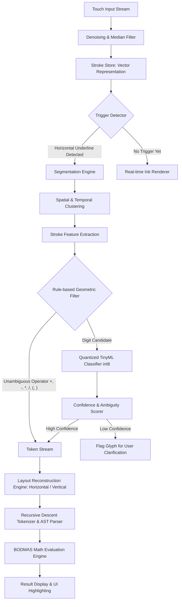

# System Architecture — Digital Slate Calculator

## 1. Project Understanding (Executive Summary)
The Digital Slate Calculator is an offline, standalone embedded system running on an ESP32-2432S028 ("Cheap Yellow Display") 2.8-inch resistive touchscreen board. Users write arithmetic expressions directly on the screen using a stylus or finger. Upon drawing an underlined horizontal trigger stroke beneath the written expression, the on-device hybrid TinyML engine detects the trigger gesture, segments strokes into glyphs, classifies operators via geometric rules and digits via a compact int8-quantized neural network, reconstructs the mathematical expression (horizontal and vertical layouts), parses the syntax using strict BODMAS rules, and renders the result directly below the trigger line. The system operates with zero cloud connectivity or host tethering at runtime, emphasizes deterministic calculation, and flags low-confidence glyphs for user correction instead of guessing.

---

## 2. Hardware Landscape: Known vs. Unknown (ESP32-2432S028)

| Component | Known (CYD Family Baselines) | Unknown / Requires P1 Verification |
| :--- | :--- | :--- |
| **SoC** | ESP32-D0WD-V3 (Dual-core Xtensa LX6 @ 240 MHz, 520 KB SRAM) | Specific silicon revision; internal SRAM available after bootloader. |
| **Display Controller** | 2.8" 320x240 TFT LCD; typically ILI9341 (SPI) | Controller IC model (ILI9341 vs ST7789 variant); RGB vs BGR color format; inversion registers. |
| **Touch Controller** | Resistive 4-wire touch overlay with XPT2046 controller IC | Dedicated SPI bus pins vs shared SPI bus with TFT; IRQ pin connectivity; pressure calibration coefficients. |
| **Flash & PSRAM** | Typically 4 MB SPI flash | Presence of external PSRAM (most standard units have 0 MB PSRAM); flash mode (DIO vs QIO) and flash speed (40MHz vs 80MHz). |
| **Backlight Control** | Controlled via transistor switch on GPIO | Exact GPIO (commonly GPIO 21, 27, or 4); active HIGH or active LOW; PWM frequency support. |
| **Peripherals** | Micro-SD slot (SPI), RGB LED, LDR (light sensor), speaker connector | Exact SD CS pin; RGB LED pinout (inverted logic common); pin conflict analysis for touch SPI. |

---

## 3. Recommended Recognition Architecture

### Why this fits the ESP32:
- **RAM Constraints**: Without assuming PSRAM, internal available SRAM is ~280–320 KB. Full-frame 320x240 RGB565 buffers require 153.6 KB, which is prohibitive if retained simultaneously with network buffers and TFLM arenas. Instead, strokes are stored purely as **compact coordinate arrays** (16-bit X, 16-bit Y, timestamp: 6 bytes/point; max 32 strokes × 100 points = ~19.2 KB). 
- **Inference Budget**: Isolated character classification uses an int8-quantized CNN or shallow MLP (<25 KB model flash size, <18 KB tensor arena).
- **Execution Speed**: Hybrid routing ensures simple operators (+, -, *, /) bypass neural inference completely using $O(1)$ geometric invariants (aspect ratio, intersections, stroke count). Neural inference is invoked only for segmented digit candidates (0–9), taking <20 ms per digit at 240 MHz.

---

## 4. Subsystem Design Specifications

### 4.1 Trigger Line Detection
- **Geometric Criteria**:
  1. **Temporal Order**: Must be the most recently completed stroke.
  2. **Vertical Location**: Bounding box top must sit below the vertical centroid/bottom of all previous strokes (with configurable tolerance $\Delta y$).
  3. **Aspect Ratio & Width**: Stroke bounding box aspect ratio $W / H \ge 4.0$, with total horizontal span covering $\ge 60\%$ of the expression's overall bounding box width.
  4. **Straightness / Curvature**: Ratio of Euclidean end-to-end distance to accumulated stroke arc length $\ge 0.88$.
  5. **Direction**: Dominantly horizontal ($\lvert \Delta x \rvert \gg \lvert \Delta y \rvert$).
- **Anti-false-positive Rule**: If the stroke passes through the vertical center band of neighboring glyphs, it is categorized as a minus sign, fraction bar, or strike-through—never a trigger line.

### 4.2 Horizontal Expression Reconstruction
- **Glyph Clustering**: Strokes are grouped into glyphs using 2D spatial overlap of bounding boxes and temporal proximity (e.g., crossbars for `+`, `=`, `4`).
- **X-axis Ordering**: Glyphs are sorted left-to-right by horizontal coordinate $x_{\min}$.
- **Space & Concatenation**: Inter-character gaps are compared against the average glyph width $\bar{W}$. If gap $< 0.45 \bar{W}$, adjacent digits are concatenated into multi-digit numbers.

### 4.3 Vertical Expression Reconstruction
- **Row Detection**: Glyphs are partitioned into vertical bands/rows based on $y$-overlap.
- **Column Alignment**: Digits are right-aligned (or decimal-aligned) across rows.
- **Operator Attribution**: The trigger line forms the bottom boundary line. If an operator (`+` or `-`) is drawn to the left of the bottom operand row, that operation is applied down the columns. **Rule**: If two numbers are vertically stacked without an explicit operator symbol, the engine flags an ambiguous layout and prompts the user rather than blindly assuming addition.

### 4.4 BODMAS Tokenizer & Parser
- **Formal Grammar**:
  $$\text{Expression} \to \text{Term} \; (('+' \mid '-') \; \text{Term})^*$$
  $$\text{Term} \to \text{Factor} \; (('*' \mid '/') \; \text{Factor})^*$$
  $$\text{Factor} \to ('+' \mid '-')? \; (\text{Number} \mid '(' \; \text{Expression} \; ')')$$
- **Associativity & Precedence**: Strict left-to-right evaluation within identical precedence tiers ($24 / 6 \times 2 = (24 / 6) \times 2 = 8$).
- **Robustness**: Syntax errors, unmatched parentheses, divide-by-zero, and integer/float overflows produce explicit, human-readable error messages on the screen.

---

## 5. Technical Risks & Concrete Mitigations

| Risk | Description | Concrete Mitigation |
| :--- | :--- | :--- |
| **Digit Segmentation** | Touching or overlapping strokes blending adjacent digits together. | Temporal stroke boundary tracking; horizontal projection histograms; maximum character aspect ratio constraints; split candidate scoring. |
| **3 vs 8 Confusion** | Loose or poorly looped 8 resembles 3; tight 3 loops resemble 8. | Topological loop detection (Euler number): 8 contains two closed internal loops or a self-intersection; 3 possesses open left-facing cusps and zero closed loops. |
| **1 vs 7 Confusion** | European-style 1 has an upstroke resembling 7; flat 7 looks like 1. | Horizontal top-stroke detector: 7 exhibits a prominent horizontal top segment ($W_{\text{top}} > 0.4 W$) followed by a sharp downward corner; 1 has a monotonic vertical profile. |
| **0 vs 6 Confusion** | Incomplete 0 leaves a top gap; 6 top tail loops inward. | Centroid vertical asymmetry and curvature derivative. 0 has vertical symmetry with centroid near center; 6 has high loop density in lower half and top tail inflection point. |
| **5 vs 6 Confusion** | Cursive single-stroke 5 resembles 6. | Stroke count heuristics (standard 5 is 2 strokes). For single-stroke 5, detect sharp top-left vertex/corner angle ($< 100^\circ$); 6 has a smooth, continuous convex curve at top. |
| **Minus vs Trigger Line** | Minus mistaken for trigger, prematurely triggering evaluation. | Length and vertical alignment: Minus length is comparable to character width ($\le 1.5 \times \bar{W}$) and sits at mid-cap height; Trigger line length $\ge 2.5 \times \bar{W}$ and strictly below character baselines. |
| **Touchscreen Noise** | Resistive touch jitter, contact bounce, and coordinate dropout. | Real-time 3-point median filter on $(x, y)$, pressure thresholding ($Z > Z_{\min}$), minimum movement delta threshold ($d > 2\text{px}$), and Douglas-Peucker stroke decimation. |

---

## 6. Simplest Realistic Offline Implementation
1. **Interactive Canvas**: Screen boots to a cleared canvas with header/status bar.
2. **Immediate Feedback**: Touch coordinates immediately draw anti-aliased or bresenham line segments on TFT. Raw $(x, y, t)$ vectors are appended to an in-memory stroke list.
3. **Trigger Evaluation**: When a stroke satisfies trigger geometry:
   - Stroke drawing pauses.
   - Glyphs are segmented and sorted.
   - Operators identified via geometry; digits rendered to $28 \times 28$ grayscale bounding boxes and evaluated via TFLite Micro int8 model.
   - Tokens parsed through recursive descent.
   - Result rendered below trigger line in green.
4. **Correction / Clear**: Tapping a "Clear" icon or tapping an uncertain red-boxed glyph clears the canvas or opens a correction prompt.

---

## 7. Tooling, Dependencies, and PC Testing Strategy

- **PC Host Environment**:
  - Compiler: GCC / Clang / MSVC with C++17.
  - Testing: Header-only lightweight test harness (e.g., `catch2` or zero-dependency custom assertions) compiling pure-logic modules (`geometry`, `parser`, `evaluator`) natively on PC.
  - Test Input: JSON-serialized stroke recordings saved from hardware or simulator.
- **TinyML & Dataset Tools (PC)**:
  - Python 3.10+ (`numpy`, `scikit-learn`, `tensorflow`/`keras` or `pytorch`).
  - Conversion: TensorFlow Lite flatbuffer export with full int8 post-training quantization.
  - Datasets: Real captured stylus strokes from CYD hardware supplemented with QuickDraw/CROHME mathematical stroke subsets.
- **Embedded Target**:
  - *Hardware-dependent choices (Arduino vs ESP-IDF, TFT_eSPI vs LovyanGFX) are deferred to Phase P1 diagnostic results.*

---

## 8. Review and Confirmation of Phases P1–P12

The proposed sequence P1–P12 is structurally sound and adheres to progressive dependency isolation:
- **P1**: Hardware diagnostics (resolve all unknowns).
- **P2**: Display & touch driver baseline (confirmed responsive touch and rendering).
- **P3**: Geometry engine & stroke preprocessing (pure logic, PC tested).
- **P4**: Tokenizer, AST parser & calculation engine (pure logic, PC tested).
- **P5**: Real-hardware stroke data collection firmware.
- **P6**: TinyML model training, quantization & export (Python / PC).
- **P7**: On-device classifier integration & hybrid routing.
- **P8**: Trigger line detection & gesture engine integration.
- **P9**: Horizontal multi-digit expression recognition & evaluation.
- **P10**: Vertical column arithmetic layout engine.
- **P11**: Ambiguity detection, confidence scoring & interactive UI.
- **P12**: Performance profiling, hardening, final documentation freeze.

*Decision*: Retain the proposed order without modifications.

---

## 9. Required Input from User for Phase P1
To complete the hardware diagnostics in Phase P1, please provide:
1. **Board Markings**: Text printed on the back silkscreen (e.g., `ESP32-2432S028R`, `ESP32-2432S028_V1.2`, or `CYD`).
2. **Chip Markings**: Label on the ESP32 module can (e.g., `ESP32-WROOM-32`, `ESP-WROOM-32D`, `ESP32-WROVER`).
3. **Photos (if possible)**: Clear photos of the front and back of the board, highlighting the display ribbon connector and ICs.
4. **Serial Monitor Access**: Ability to flash diagnostic firmware and copy/paste serial console logs at 115200 baud.
